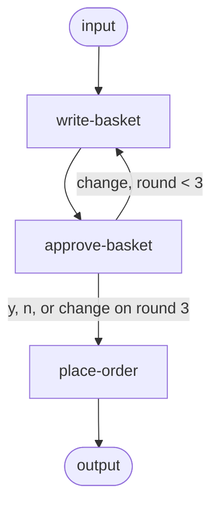

# Part 11: Agent Framework workflow checkpoints in C# with Claude

A workflow that writes the household's weekly shopping basket, stops for a person's approval and saves itself to disk. The first run writes the basket with Claude Haiku 5.5, raises the approval request through a `RequestPort` and exits. The next run resumes from the checkpoint and asks the question in the console. `y` places the order, `n` (or just Enter) places none, and any other text is a change: the basket goes back to the shopper, which revises it, and the person is asked again. After three baskets, a further change ends the run without an order. The basket reaches the other steps through the workflow's shared state, and each step reports its progress with a custom `WorkflowEvent`. This is the code from [Agent Framework workflow checkpoints in C# with Claude](https://kootstra.io/writing/agent-framework-workflow-checkpoints-csharp/).

The graph has a loop, like the one in [part 10](../10-workflow-parallel/):



Each `Basket` carries its round (1 to 3), and the console copies it into the person's `BasketDecision`. The two edges out of `approve-basket` test only that decision, so the cap is in code: the model can't keep the loop going.

## What you need

Install these first (once for all samples), as described in [docs/prerequisites.md](../../docs/prerequisites.md):

- **.NET 10 SDK**
- **An Anthropic API key**

This sample has no Aspire AppHost: the second run reads your answer from the console, and Aspire doesn't connect a terminal to the apps it runs. The two runs are also two separate processes, which is the point of the sample.

## Run it

Set the key for this terminal first (`read -rs` keeps it out of your shell history):

```sh
read -rs ANTHROPIC_API_KEY && export ANTHROPIC_API_KEY
```

Start the week's shop from this folder. The app writes the basket, saves the run to a `checkpoints` folder next to its build output (`WeeklyShop/bin/Debug/net10.0/checkpoints`) and exits:

```sh
dotnet run --project WeeklyShop
```

```text
[basket written] 17 items, 514 output tokens
Basket 1 of 3:
  500 g chicken breast
  2 bell peppers
  [...]
  150 g mushrooms
  100 g pepperoni
Waiting for approval. Run the app again to answer.
```

Run it again. It finds the checkpoint, shows the basket again and asks. Answer `y` to approve, `n` (or just Enter) to reject, or type what to change. A change makes one model call for the revised basket, which the same process asks about next:

```sh
dotnet run --project WeeklyShop
```

```text
Basket 1 of 3:
  500 g chicken breast
  [...]
  2 pizza bases or 500 g pizza dough
  200 g tomato passata
  250 g mozzarella
  150 g mushrooms
  100 g pepperoni
Approve this basket? (y, n or a change) We are away on Saturday, no pizza
[basket revised] 13 items, 471 output tokens
Basket 2 of 3:
  500 g chicken breast
  [...]
  2 vegetable stock cubes
  150 g mushrooms
Approve this basket? (y, n or a change) y
[order placed] 13 items
Ordered 13 items.
```

The resumed run makes no model call for the first basket: it comes from the checkpoint. The run is saved after every step here too, so if the process stops while the revised basket waits for an answer, the next run resumes there and shows `Basket 2 of 3` without calling the model. A change to the third basket ends the run with `No order placed: still a change after basket 3: <your change>`.

When the run is done, the app deletes the `checkpoints` folder, so the next run starts a new week. If the first run fails (for example with an invalid key), it prints the error, exits with code 1 and leaves no checkpoint, so the next run starts the week again.

## Run the tests

```sh
dotnet test
```

29 tests, no API calls.

- `BasketTests` and `BasketDecisionTests` check how the agent's text becomes a list of items, how a console answer becomes a decision, and that both carry the round.
- `ShopWorkflowTests` build the workflow from `ShopWorkflow.Build` with the shopper on a stubbed chat client, and run it as separate "processes", each with its own workflow and its own `FileSystemJsonCheckpointStore` on a temporary folder. They check that the first run stops at the request and leaves a checkpoint, that the resumed run raises the same request again without calling the model, that `y` places the order with the basket from shared state and `n` places none, that a change sends the basket back to the shopper with the current basket and the change in the prompt and asks again, that a change to the third basket ends without an order after two revisions, that a process stopped after a change leaves the revised basket for the next process, that each step raises a `ShopProgressEvent`, that the first run ends as `PendingRequests` only when it reached the request (not after a cut-off answer or a failed model call), that a shopper answer cut off at the token limit fails the step, and that resuming after renaming a step throws `InvalidDataException`.
- `SharedStateTests` check that the next step reads the basket from the `shop` scope, and that a read without the scope name finds nothing.

## Files

| File | What it is |
| --- | --- |
| `WeeklyShop/Program.cs` | The agent, the checkpoint store, starting or resuming the run, and the event loop |
| `WeeklyShop/ShopWorkflow.cs` | The graph, with the loop back to `write-basket` and `MaxRounds` |
| `WeeklyShop/WriteBasketExecutor.cs` | Writes the first basket or revises the one in shared state, stores it there and sends it to the port |
| `WeeklyShop/PlaceOrderExecutor.cs` | Reads the basket from shared state and acts on the person's decision |
| `WeeklyShop/ShopProgressEvent.cs` | The custom progress event |
| `WeeklyShop/Basket.cs` | The `Basket` and `BasketDecision` records, each with its round |
| `WeeklyShop.Tests/` | Tests with a stubbed chat client and a temporary checkpoint folder |

The article shows every file in full. It shows the `WatchAsync` local function before the `else` branch that resumes the run; in `Program.cs` it sits at the end.

## Try it

- Run the app once, then change the ID of `place-order` to `order` and run it again. Read the exception from `ResumeStreamingAsync`.
- Remove `scopeName: "shop"` from the `ReadStateAsync` call in `PlaceOrderExecutor`, resume a waiting run and approve it: `place-order` fails with `No basket in state.`
- Set `MaxRounds` to 1 and answer the first basket with a change: the run ends without an order and without a second model call.
- Change `blockOnPendingRequest: canAnswer` to `true` and start a new week. The basket appears, and the app waits for an answer that the first run can't give.
